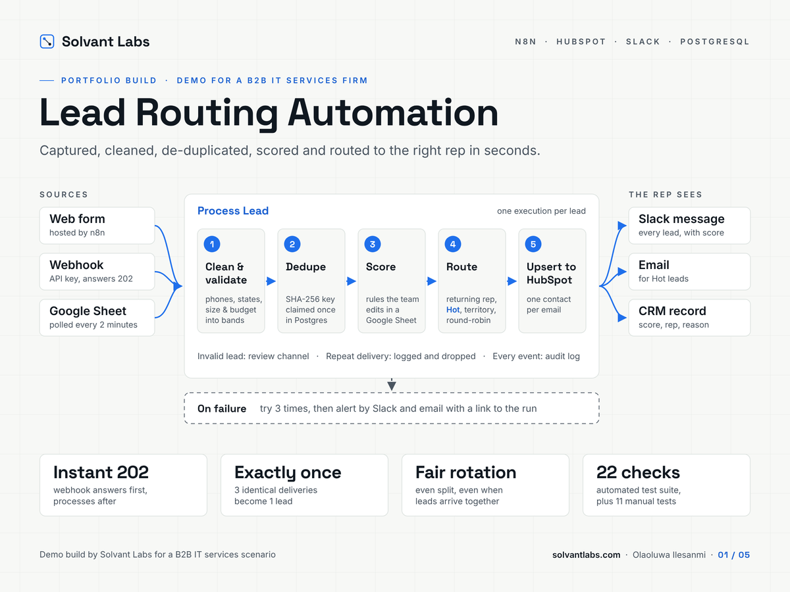
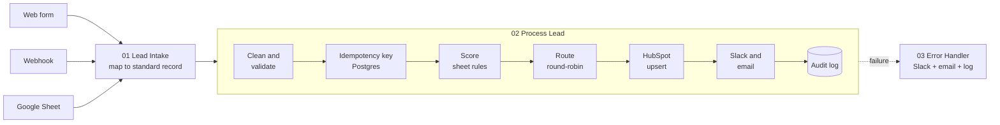
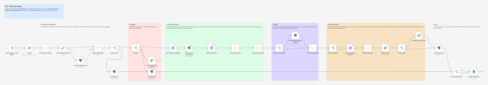
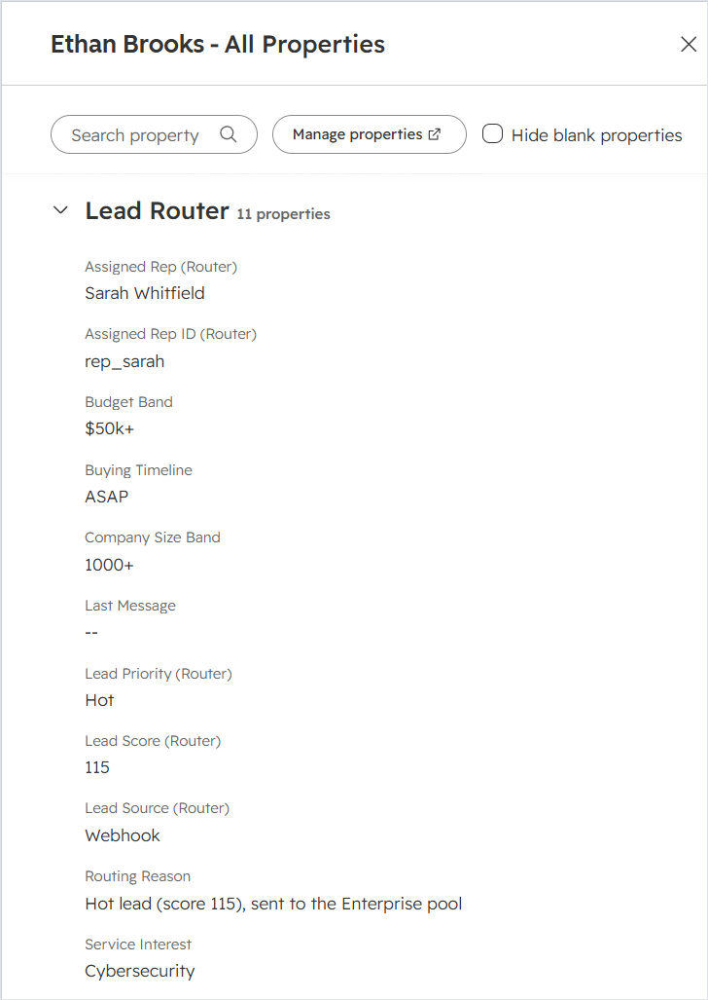
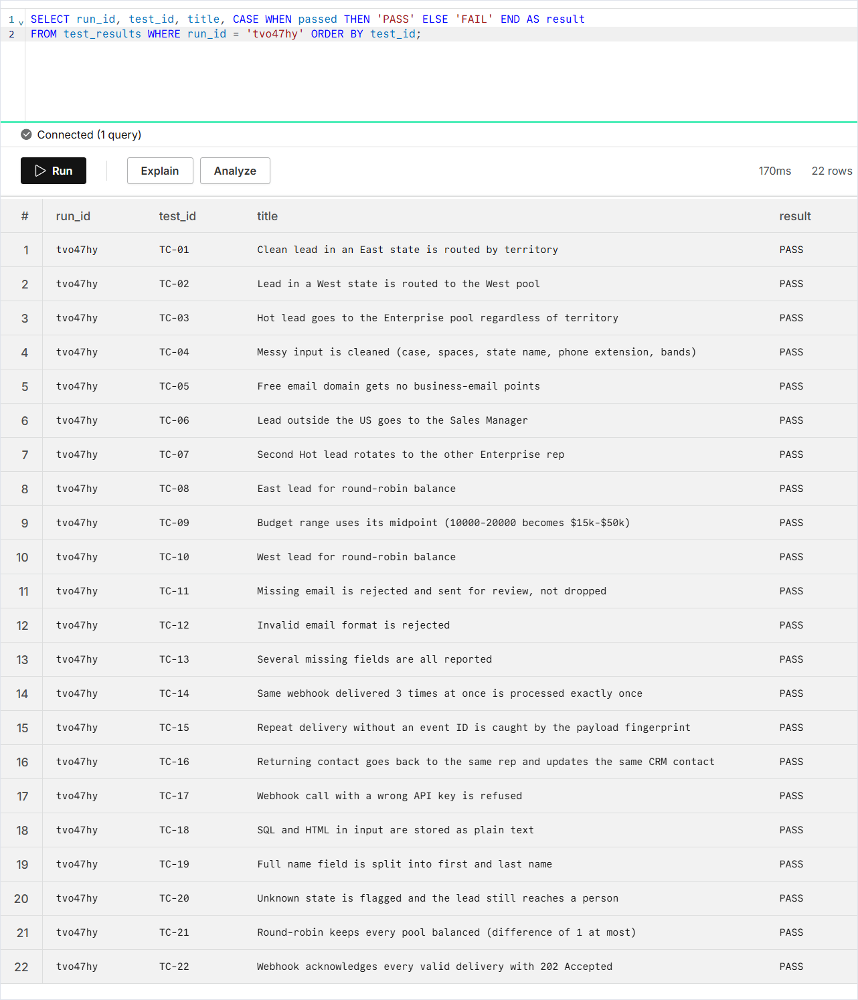

# Lead Routing Automation in n8n

**Multi-source lead intake, de-duplication, scoring and round-robin routing into HubSpot, with Slack and email alerts, an audit log and an automated test suite.**



**[Watch the 2-minute walkthrough](https://drive.google.com/file/d/1Say_U_PUfUunyLVcofE2NfiWntkjNvlX/view?usp=sharing):** a demo lead through the running build, its duplicate, a failure and retry, the rules sheet and the test results.

> **Demo build by [Solvant Labs](https://solvantlabs.com).** The scenario is a B2B IT services firm with a seven-person sales team; the firm and its reps are samples, not a client. The workflows, database, tests and documentation are real. The test run below used n8n Cloud with a Neon Postgres database, and the repo includes a Docker Compose stack to self-host the same build.

## The problem

Leads arrive from a website form, partner webhooks and a spreadsheet the team fills in by hand. Someone copies each one into the CRM and pings a rep. Leads get duplicated, follow-up is slow, the same reps get everything, and nobody can say who received which lead.

## What this build does

| Step | How |
|---|---|
| **Capture** | Web form, authenticated webhook (answers `202 Accepted` immediately, then processes) and a Google Sheet polled every 2 minutes, all mapped into one standard lead record |
| **Clean and validate** | Names, emails, phone numbers (international format), US states, company size and budget bands; invalid leads go to a review channel instead of disappearing |
| **De-duplicate** | SHA-256 idempotency key claimed atomically in Postgres, so a webhook delivered three times at once is processed once; HubSpot upsert by email so one person is one contact |
| **Score** | Rules the sales team edits in a Google Sheet (company size, budget, service, timeline, business email, job title, country) |
| **Route** | Returning contacts keep their rep; Hot leads go to Enterprise; otherwise by territory; round-robin inside each pool with state in Postgres; unavailable reps skipped; manager fallback |
| **CRM** | HubSpot contact created or updated with a "Lead Router" property group: score, priority, assigned rep, routing reason, source and more |
| **Notify** | Slack message to the rep for every lead, email for Hot leads |
| **Log and recover** | Every event in an audit table with its n8n execution ID; every external call retries; failures alert by Slack and email with a link to the run; retries cannot create duplicates |

## Architecture



| Workflow | Purpose |
|---|---|
| `00 - Setup & Connection Check` | Creates the database tables and HubSpot properties, then checks every connection and reports PASS or FAIL |
| `01 - Lead Intake` | Form, webhook and Google Sheet triggers |
| `02 - Process Lead` | The pipeline above, one execution per lead |
| `03 - Error Handler` | Alerts and logs any failed run |
| `99 - Test Runner` | 22 automated checks against the live webhook |

The full node-by-node walkthrough and the reasoning behind each design choice are in [How It Works](docs/03-how-it-works.md).

## Screenshots

The `02 - Process Lead` workflow (click to open it full size):



| A Hot test lead in HubSpot | The 22 automated checks, run tvo47hy |
|---|---|
|  |  |

## Reliability, tested

The automated suite covers clean and messy input, free email domains, leads outside the US, invalid and incomplete leads, three simultaneous deliveries of the same webhook, repeat deliveries without an event ID, returning contacts, a wrong API key, SQL and HTML injection attempts and round-robin balance. Manual tests cover the form, the sheet, rep availability, scoring changes, a HubSpot outage followed by a retry (which must leave exactly one contact and one notification), a Slack outage, and a load check of 12 leads sent to one pool at the same instant.

**Latest run (2026-10-05, n8n Cloud):** 22 of 22 automated checks and 10 of 11 manual tests passed (the Slack-outage test was not run); 12 simultaneous leads split 6 and 6; a forced HubSpot outage raised an alert in under 10 seconds and recovered on retry with no duplicate contact or message.

### What the live run caught

The first run against the real services found two limits that local stand-ins never show:

- **Google Sheets quota.** Google allows 60 reads per minute per service account, and each lead read three config tabs, so a 23-lead burst was throttled. Each lead now reads all three tabs in one `values:batchGet` call, with retries that ride out short spikes.
- **HubSpot's firewall.** HubSpot's edge answers `403` to records containing text that looks like code. The SQL-injection test lead failed its run there. Such leads are now flagged, routed and logged as usual, kept out of HubSpot, and the Slack message says so.

See the [Test Protocol](docs/04-test-protocol.md) and [`tests/test-protocol.xlsx`](tests/test-protocol.xlsx).

## Run it yourself

Requirements: Docker Desktop, plus free Slack, HubSpot and Google accounts.

Copy the settings template and fill in the passwords and encryption key:

```bash
cp .env.example .env
```

Start n8n (port 5678), Postgres and Adminer (port 8080), then import the workflows:

```bash
docker compose up -d
docker compose exec n8n n8n import:workflow --separate --input=/workflows
```

The [Setup Guide](docs/02-setup-guide.md) covers the accounts, credentials, config sheet and publishing, step by step.

### Webhook contract

```http
POST /webhook/lead-intake
Content-Type: application/json
X-API-Key: <your key>
X-Event-Id: <optional, the sender's unique delivery ID>

{
  "event_id": "optional unique ID",
  "first_name": "Ava", "last_name": "Martin",
  "email": "ava@example.com", "phone": "(617) 555-0101",
  "company": "Harborview Dental Group", "job_title": "Office Manager",
  "state": "MA", "country": "US",
  "company_size": "35", "budget": "$8,000",
  "service_interest": "Managed IT Support", "timeline": "1-3 months",
  "message": "We need help desk support for 3 offices."
}
```

Returns `202 Accepted` immediately; processing happens after the response. Required: first name, a valid email, company and service interest. `name` (full name) and camelCase field names are also accepted.

## Repository layout

```
docker-compose.yml        n8n 2.41.7, Postgres 17, Adminer
.env.example              settings template (copy to .env)
db/schema.sql             tables and reporting views
db/init/                  creates the least-privilege database user on first start
workflows/                the five n8n workflows (import with the n8n CLI)
config/                   config sheet template (.xlsx) and the same tabs as CSV
tests/test-protocol.xlsx  test cases, results and acceptance-criteria traceability
docs/                     brief, setup guide, walkthrough and test protocol
```

## Stack

n8n (tested on n8n Cloud; the Docker stack pins 2.41.7) · PostgreSQL 17 (Neon in the test run) · HubSpot CRM API v3 · Slack Web API · Google Sheets API · SMTP · Docker Compose

## About

Built by **Olaoluwa Ilesanmi** at [Solvant Labs](https://solvantlabs.com), an AI automation studio for small businesses. Eight years in pharmaceutical quality assurance taught me that a process is only as good as the way it fails, so everything here is built to fail loudly, recover cleanly and leave a record.

[Hire me on Upwork](https://www.upwork.com/freelancers/~0169689858c842b999)
