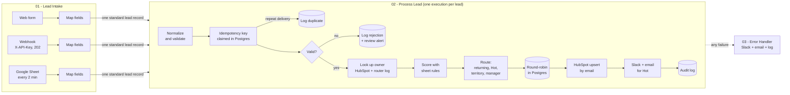

# How It Works

This document walks through every workflow and node, then explains the design decisions behind them. It is written so you can explain any part of the build on a client call.

## The big picture

Every requirement in the [project brief](01-project-brief.md) maps onto one of these steps:

| Requirement | Where it lives |
|---|---|
| Capture from forms, webhooks, sheets | 01 - Lead Intake |
| Validate and clean (duplicates, formatting, required fields) | 02, stages 1 and 2 |
| Enrich or score on defined criteria | 02, stage 3 (rules in the `scoring_rules` tab) |
| Route by round-robin, territory or score | 02, stage 4 |
| Create or update CRM records | 02, stage 5 (HubSpot upsert) |
| Instant notification to the owner | 02, stage 5 (Slack, plus email for Hot leads) |
| Log everything, handle errors, alert on failure | 02, stage 6, plus 03 - Error Handler |

---

## 01 - Lead Intake

Three triggers, one job: turn whatever arrives into the same **standard lead record** and pass it on.

| Node | What it does | Why it is built this way |
|---|---|---|
| **Contact Sales Form** | n8n-hosted form at `/form/contact-sales`. Every field has a field name, so the output keys are already `first_name`, `email` and so on. Bots are ignored. | The form doubles as the demo's "website". In production the website's own form would post to the webhook instead. |
| **Map Form Fields** | Sets `source = form` and uses the form's `submittedAt` as the submission time. | The submission time feeds the duplicate check later. |
| **Lead Webhook** | `POST /webhook/lead-intake`, protected by the `X-API-Key` header. Answers **202 Accepted** the moment the request is authenticated. | Answering before processing means the sender never times out and retries, which is the most common cause of duplicate webhooks. |
| **Map Webhook Fields** | Maps the JSON body into the standard record. Accepts `snake_case` or `camelCase` names, a full `name` field, and the event ID from the body (`event_id`) or the `X-Event-Id` header. | Tolerant mapping means a partner integration does not break over field naming. |
| **Every 2 Minutes → Config → Read Intake Sheet** | Polls the `intake` tab. | Polling with a status column is easier to audit than a "row added" trigger: you can see in the sheet itself which rows were picked up. |
| **New Rows Only** | Keeps rows whose `status` is blank and that have at least a name, email or company. | Skips processed rows and stray empty rows. |
| **Mark Rows Queued** | Writes `queued` into each new row before anything else happens. | A row is never picked up twice, even if the next poll starts before processing ends. |
| **Restore Row Data** | Brings back the full rows (the update node only returns the cells it wrote). | Keeps the data flowing without a second read. |
| **Map Sheet Fields** | Maps columns into the standard record, keeping the `row_number`. | Process Lead uses the row number to write the final status back. |
| **Loop Over Rows → Send Row to Process Lead** | Sends each row as its own execution. | One lead per execution makes every lead independently retryable. |
| **Send to Process Lead** | Calls 02 without waiting for it to finish. | The intake stays fast; a slow CRM call never holds up the form or webhook. |

---

## 02 - Process Lead

Called once per lead. Every lead ends in exactly one audit row: `routed`, `unassigned`, `rejected` or `duplicate_dropped`.

### Stage 1: Clean and de-duplicate

| Node | What it does |
|---|---|
| **When Called by Lead Intake** | Accepts whatever 01 sends. |
| **Config** | Sheet ID, Slack channels, HubSpot Hub ID, sender email, score thresholds, fallback pool. Everything a person might change lives here or in the sheet, not inside other nodes. |
| **Normalize & Validate** | Trims and capitalizes names, lowercases emails, converts phones to international format (`(617) 555-0101` becomes `+16175550101`), converts state names to codes (`new york`, `N.Y.` and `NY` become `NY`), maps company size and budget into bands (`35` becomes `11-50`, `25k` becomes `$15k-$50k`, a range uses its midpoint), standardizes service and timeline, flags free email domains, and lists validation errors. It also flags text that looks like code (HTML tags or SQL injection), and builds the material for the idempotency key. |
| **Hash Idempotency Key** | SHA-256 of that material, using n8n's Crypto node. |
| **Claim Idempotency Key** | Inserts the key into `processed_events`. The primary key makes this atomic: if two copies of the same webhook arrive in the same second, exactly one insert wins. |
| **Merge Claim Result** | Combines the lead with the claim result. |
| **Is New Event?** | Winner continues. Loser goes to **Log Duplicate** and stops. |

**What goes into the key:** the source's own event ID when it sends one; otherwise the email plus the source's submission timestamp; otherwise a fingerprint of the content. Never the time *we* received it, because a retried delivery arrives later but must produce the same key.

**Two exceptions let a key be claimed again:** a retry of the same lead (same `lead_id`, for example after a dropped database connection), and a key stuck in `processing` for more than 15 minutes after a crash. So a failure can never block a lead permanently.

### Stage 2: Validate

| Node | What it does |
|---|---|
| **Is Valid?** | Requires first name, a valid email, company and service interest. |
| **Log Rejection** | Writes the reasons to `lead_log` and marks the key `rejected`, so a repeat of the same bad lead does not alert twice. |
| **Alert: Lead Needs Review** | Posts the lead and its problems to `#lead-alerts` so a person can fix and resend it. Nothing is dropped silently. |

### Stage 3: Look up and score

| Node | What it does |
|---|---|
| **Find Contact in HubSpot** | Searches HubSpot by email. Catches people who are already in the CRM, including ones created by hand. |
| **Find Previous Assignment** | Checks the router's own log for the last rep who handled this email. Unlike HubSpot search, which can lag a few seconds behind writes, this is instant. |
| **Read Config Tabs** | Reads `scoring_rules`, `territories` and `reps` in one Sheets API call (`values:batchGet`). Google allows 60 reads per minute per service account, so one call per lead instead of three keeps a burst of leads under the limit. Retries up to 5 times, 5 seconds apart. |
| **Parse Config Tabs** | Turns each tab into rows keyed by its header row, for scoring and routing. |
| **Score & Choose Pool** | Applies every active scoring rule, sets priority (Hot 70+, Warm 40 to 69, Cold below 40), then decides the route. |

Scoring rules support the operators `equals`, `not_equals`, `in`, `not_in`, `contains_any` (whole words, so "director" does not match "cto"), `gte`, `lte`, `not_empty` and `is_empty`. Changing points or switching a rule off in the sheet takes effect on the next lead.

### Stage 4: Route

The decision, in order:

1. **Returning contact:** the previous rep (from the router log, then HubSpot's `lr_assigned_rep_id`, then a HubSpot owner matched to a rep) keeps the lead if they are available.
2. **Hot lead:** the Enterprise pool.
3. **Territory:** the `territories` tab maps the US state to East or West.
4. **No territory:** the manager pool.
5. **Nobody available in the pool:** falls back to the manager. If the manager is unavailable too, the lead is still created in HubSpot, marked unassigned, and posted to `#lead-alerts`.

| Node | What it does |
|---|---|
| **Needs Round-Robin?** | Returning contacts skip the rotation. |
| **Pick Next Rep (Round-Robin)** | Gives the lead to the available rep in the pool who was assigned least recently, using `FOR UPDATE SKIP LOCKED` so two simultaneous leads go to two different reps. |
| **Finalize Assignment** | Combines the decision with the picked rep and builds the HubSpot properties, leaving out blank values. |

### Stage 5: CRM and notify

| Node | What it does |
|---|---|
| **Send to HubSpot?** | Skips the CRM for a lead flagged as looking like code. HubSpot's firewall answers 403 to such records, which would fail the run, so the lead is routed and logged as usual and the Slack message says it was not added to HubSpot. |
| **Upsert Contact in HubSpot** | One call to HubSpot's batch upsert endpoint with `idProperty: email`: creates the contact, or updates it if the email exists. HubSpot returns whether it was new. |
| **Build Notifications** | Writes the Slack message, the Hot-lead email and the audit record in one place. |
| **Notify in Slack** | Posts to `#leads`, mentioning the rep if their Slack member ID is in the sheet. Unassigned leads go to `#lead-alerts` instead. |
| **Is Hot Lead? → Email Hot Lead to Rep** | Hot leads also get an email to the rep. |

### Stage 6: Log

| Node | What it does |
|---|---|
| **Log Routed Lead** | Marks the key `done` and writes the audit row in one SQL statement. |
| **From Google Sheet? → Update Intake Row** | For sheet leads, writes `routed`, `rejected` or `duplicate`, the rep or reason, and the time back to the row. Duplicate and rejected leads take the same path. |

---

## 03 - Error Handler

Set as the error workflow on 01 and 02, so it runs whenever either fails after its retries.

| Node | What it does |
|---|---|
| **Error Trigger** | Receives the failed workflow's name, the step that failed, the error and the execution ID and link. |
| **Config** | Alert channel and email addresses. |
| **Build Alert** | Formats the Slack text, email and log record. Handles both shapes n8n sends (a failed execution or a trigger that failed to start). |
| **Alert in Slack → Alert by Email → Log Error** | Each step continues on error, so if Slack is what broke, the email still goes out. |

**Recovery:** fix the cause (for example renew a key), open the execution from the alert link and click **Retry**. n8n resumes from the failed step with the original data. Because the CRM write is an upsert and the key is already claimed, a retry cannot create a second contact or a second notification. Test M-06 in the [test protocol](04-test-protocol.md) checks exactly this: break the HubSpot key, confirm the alert, fix it, retry, and confirm one contact and one Slack message.

---

## 00 - Setup & Connection Check

Run by hand. Creates the database tables (same SQL as `db/schema.sql`, safe to repeat), checks the HubSpot key, prints the Hub ID, creates the **Lead Router** property group and its 11 contact properties, reads the `reps` tab and posts a test message to Slack. **Setup Summary** shows PASS or FAIL for each, with the reason. Every check continues on error so one failure does not hide the others.

## 99 - Test Runner

Run by hand once 01, 02 and 03 are published. It sends 23 requests to the live webhook covering 20 scenarios, waits for processing, reads what the router logged, and compares it with the expected result for each case. Two more checks cover round-robin balance and the 202 responses. Results go to the `test_results` table. See [04 - Test Protocol](04-test-protocol.md).

---

## Data model

| Table or view | What it holds |
|---|---|
| `processed_events` | One row per incoming event: idempotency key, status (`processing`, `done`, `rejected`), attempts. |
| `rep_rotation` | When each rep last received a lead, and how many they have had. |
| `lead_log` | The audit trail: one row per event with score, route, rep, reason, HubSpot ID, execution ID and full details as JSON. |
| `test_results` | Every Test Runner result, by run. |
| `v_lead_activity` | Recent activity, newest first. |
| `v_rep_load` | Leads per rep. |
| `v_daily_summary` | Routed, unassigned, duplicates, rejected and errors per day. |
| `v_latest_test_run` | The most recent Test Runner results. |

The router connects as `lead_router_app`, a user that owns only the `lead_router` database. n8n's own data sits in a separate database.

---

## Design decisions

**Why an idempotency key instead of "check if the email exists"?** Checking first and writing second leaves a gap: two deliveries a second apart can both see "not found". A unique key in Postgres closes that gap, because the database lets only one insert through.

**Why also upsert by email in HubSpot?** The key stops repeat deliveries of the same event. The upsert stops the same person becoming two contacts when they come in through two different sources. Two layers, two different problems.

**Why keep round-robin state in Postgres?** n8n workflows do not remember anything between runs in a way that is safe under concurrency. A table does. "Least recently assigned" also stays fair when reps are added, removed or marked unavailable, which a simple counter does not.

**Why put scoring, reps and territories in a Google Sheet?** Those are business decisions the sales team changes often. Technical settings (channels, thresholds, Hub ID) stay in the Config nodes.

**Why fire-and-forget from 01 to 02?** The sender gets an instant answer, each lead becomes its own execution, and each one can be retried on its own.

**Why is every external call tried up to 3 times?** Most API failures are brief (rate limits, timeouts). Retries absorb those; anything longer reaches the error workflow and a person.

**Why parameterized SQL?** Values are passed separately from the query, so input like `Robert'); DROP TABLE lead_log;--` is stored as text. The test suite checks exactly that.

**Why publish 02 and 03?** In n8n 2.x, production runs call the *published* version of a sub-workflow and of the error workflow. An unpublished error workflow fails silently, which is the opposite of what an error workflow is for.

---

## Limits and next steps for production

| Area | Today | For a real client |
|---|---|---|
| Config reads | Three sheet reads per lead | Cache the config for a few minutes if volume grows past a few hundred leads a day |
| Old idempotency keys | Kept forever | Add a nightly cleanup of keys older than 30 days |
| Scale | Single n8n instance | n8n queue mode with workers for high volume |
| Hosting | Local Docker | A small VPS or n8n Cloud, with HTTPS and backups |
| WhatsApp alerts | Not included | Add a Twilio or WhatsApp Cloud API node next to the Slack node (needs Meta Business verification) |
| Monitoring | Alerts on failure | Add a daily summary message from `v_daily_summary` |

## How to extend it

- **New lead source:** add a trigger and a Set node that maps its fields into the standard record, then connect it to **Send to Process Lead**.
- **New scoring rule:** add a row to `scoring_rules`. No n8n change needed.
- **New rep:** add a row to `reps`. They join the rotation on their next eligible lead.
- **New pool:** add reps with the new pool name and point territories (or a scoring threshold in **Score & Choose Pool**) at it.
